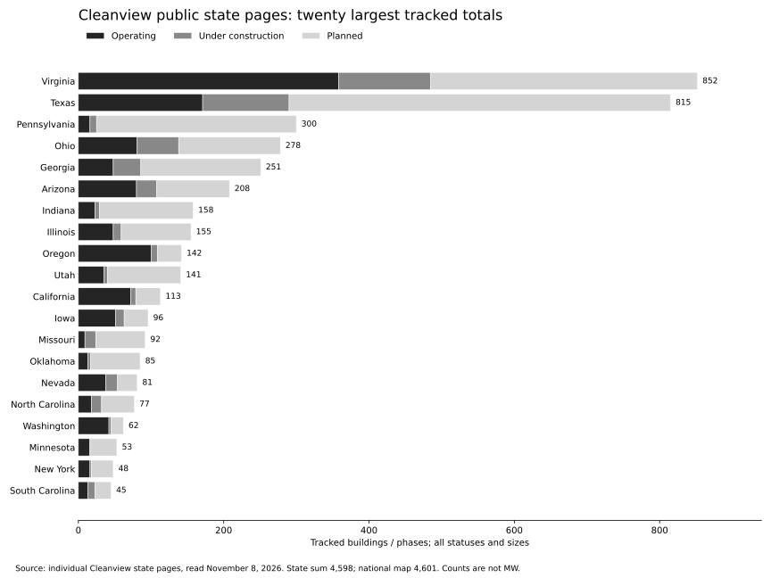

# Cleanview’s totals are reproducible in aggregate; its full building inventory is not publicly exposed

Research observations: November 8, 2026. This is a separate investigation of Cleanview’s public tracker, not a revision of our independently reviewed construction inventory. The hourly construction dispatcher remains disabled.

## What we can reconstruct

Cleanview’s public state pages account for **1,535 campuses exactly**, matching its national map. Their individual building totals add to **4,598**, against **4,601** nationally: a residual of one operating and two construction-stage records. This is an aggregate reconciliation of published numbers, not proof that we have independently located every building.

The public map’s pipeline is **3,181 records**: 2,609 planned and 572 under construction. Fully operating buildings make up the other 1,420. Our much smaller accepted inventory cannot be explained entirely by excluding operating sites: it also reflects incomplete discovery, unresolved individual-facility capacity and construction evidence, and different treatment of phases.

The practical reconstruction is a hierarchy: identify a campus, enumerate its buildings or phases, assign their individual statuses and capacities, and roll them up. A large planned campus can therefore contribute many records before most of its buildings exist. The complete state table and reproducible calculations accompany this report.

Sources: [national map](https://cleanview.co/data-centers/us), individual state links in the table, and [API documentation](https://docs.cleanview.co/api-reference/endpoint/data-centers).

## The counting unit matters more than the headline

The public map describes a data center as an individual building, rather than each colocation room or tenant. It includes hyperscale, enterprise, colocation and crypto facilities, with an emphasis on hyperscale and AI. It does not label every facility as AI versus non-AI. I found no published requirement matching our individual-facility >20 MW cutoff. That does not establish that Cleanview has no internal size rules.

Its API documentation is more qualified: a row can be a **building or phase**. Consequently, even a complete downloaded list needs a physical-building crosswalk before treating every row as a distinct footprint. It distinguishes facility power from critical IT load, supports unknown values, and allows announced-project estimates. Developer/operator, tenant and end user are separate concepts; a developer field is not necessarily the legal property owner. A projected operating year is not a verified completion date. These distinctions need to survive any comparison with our dataset.

Sources: [map definitions](https://cleanview.co/data-centers/us), [building API definitions](https://docs.cleanview.co/api-reference/endpoint/data-centers).

## The research process they disclose

Cleanview’s product page describes daily monitoring of permits, zoning, utility and SEC records. Analysts interpret the documents; AI helps with discovery. Original disclosures establish identities and capacity, while satellite observations supplement construction and location checks. The public examples combine building outlines, dates and equipment context. Its published claim of estimates within 5% of subsequent developer disclosures is not an independently audited error rate here; no complete validation sample or error distribution was recovered.

The September 16 update explains why it moved to building-level tracking: one campus can contain legacy designs, newer AI buildings and temporary structures with different construction and power timelines. It describes internal tools that bring together dozens of images per campus for analyst review. This is consistent with an analyst-led research system, rather than an assertion that an automated image detector finds every US data center.

The October 29 update describes multiple imagery sources and a power-ramp feature that assigns capacity to years. An image acquisition opportunity is distinct from an analyst update, and neither guarantees a clear usable image every five days. A dated map refresh also does not mean each underlying project was re-investigated that day.

Sources: [product methodology](https://cleanview.co/products/data-center-tracker), [September methodology update](https://newsletter.cleanview.co/p/announcing-cleanviews-biggest-update), [October platform update](https://newsletter.cleanview.co/p/new-look-new-tools).

## How satellite decomposition works

**Disclosed:** Cleanview uses historical sequences to distinguish announcements from work on the ground and to examine construction speed. Its Matador investigation compares land preparation with later images showing no vertical progress, then contrasts those sequences with other developers. Its September AWS analysis explicitly credits Copernicus Sentinel-2. The product examples credit Airbus Pléiades Neo at 30 cm resolution. This establishes use of both frequent broad-area observations and detailed commercial imagery, without proving an exclusive supplier or complete acquisition schedule.

**Technical context:** ESA lists Sentinel-2 imagery at 10 m resolution and a nominal five-day revisit. Airbus describes native 30 cm Pléiades Neo imagery. These have different uses: at 10 m, clearing and large roof changes may be visible, but small equipment generally cannot be counted reliably. A nominal three-meter-wide object spans only 0.3 of a 10 m pixel versus approximately ten 30 cm pixels across. Those are spatial calculations, not evidence of object recognition accuracy. Clouds, shadows, off-nadir views and image quality still matter.

Sources: [Matador case study](https://newsletter.cleanview.co/p/the-worlds-largest-planned-data-center), [AWS imagery example](https://newsletter.cleanview.co/p/amazon-is-building-44-gw-of-data), [ESA Sentinel-2](https://www.esa.int/Applications/Observing_the_Earth/Copernicus/Sentinel-2/), [Airbus Pléiades Neo](https://space-solutions.airbus.com/imagery/our-optical-and-radar-satellite-imagery/pleiades-neo/).

A reproducible implementation would work as follows. This is **our inferred implementation**, not a disclosed Cleanview algorithm:

1. Resolve the developer, project alias, parcel and campus boundary from documents. Record source dates and uncertainty. Do not turn a registered agent’s address into the project location.
2. Extract each proposed data-center footprint from a site plan, including building letters and construction phases. Mark offices, substations, generation and ancillary structures separately. Proposed outlines explain future building counts that satellite imagery alone cannot supply.
3. Join each outline to visible structures and record the identity crosswalk. Preserve splits, mergers, renames and phase subdivisions rather than guessing from similar names.
4. Register dated, cloud-screened images against the same footprint. Keep acquisition time distinct from download or analysis time. Compare a baseline with clearing, grading, slab, steel, enclosure and external equipment stages.
5. Use coarse imagery to screen a large portfolio for changes, then inspect higher-resolution images or records at ambiguous or important sites. Record observations and confidence per building; campus-wide clearing should not automatically mark all future buildings as started.
6. Verify operational status with company disclosures, occupancy/inspection records, energization and other evidence. A roof, chiller or generator proves neither installed servers nor commercial operation. Conversely, internal retrofit work may be invisible from above.
7. Maintain each building/phase status and schedule, then compute the campus and state totals. Keep a partially delivered facility’s remaining increment separate from its whole design capacity when answering our unfinished-construction question.

Cleanview has not publicly specified the precise stage thresholds, image-registration procedure, confidence scores, cancellation timeout, segmentation model or rules for partially commissioned buildings in the pages recovered. No independent pixel-level reconstruction was completed here: image endpoints returned rewritten representations, not inspectable original pixels. Image dates/resolutions above are publisher disclosures, not measurements we independently validated.

## Building and campus status are different calculations

The campus API documents explicit precedence, ignoring canceled rows: any construction-stage building makes the campus **Under Construction**; otherwise any operating building makes it **Operating**; otherwise it is **Planned**. Campuses with only canceled buildings are omitted. Thus one campus can have operating, construction-stage and planned capacity while receiving one status.

Its capacity totals sum known **facility-power** values by building status. Unknown-only groups remain null, and incomplete building capacity makes a campus total a lower bound. IT capacity requires a separate building-level sum. These are design-capacity allocations by status, not metered demand or necessarily the remaining unfinished increment. The provided `reconstruct_rollups.py` implements those documented rules for a legitimately obtained approved-record CSV and flags campus-less rows rather than inventing campuses.

Source: [campus API](https://docs.cleanview.co/api-reference/endpoint/data-center-campuses).

A further numerical check is possible from that page’s illustrative historical examples: Google Cedar Rapids has 97.4 operating + 200.7 construction-stage + 309.9 planned = **608 MW**, across six records. The Abilene example gives 300 operating + 900 construction-stage = **1,200 MW**, across eight. These examples illustrate aggregation; they are not current production readbacks.

## What can and cannot be inferred about capacity estimates

The published Fairwater B2 example is **338 MW facility power versus 270.4 MW IT**, an implied ratio of **1.25**. It is one building in a 17-building campus. The separate linked site-plan example enumerates nine data-center buildings and excludes two substations and an office from that building count. These are examples of decomposing a campus into functional structures, not evidence that every building has the same power density.

The historical building API examples imply different facility-to-IT ratios: **383.9 / 308 = 1.2464** for Milam Building 1 and **165 / 122.5 = 1.3469** for River Bend Building 1. They therefore do not support a universal 1.25 conversion. Design-capacity ratios should not be represented as measured operating PUE. Nor does a 122.5 MW example establish the source or method of allocation between River Bend buildings.

Cleanview’s product comparison puts Cedar Rapids’ six-building estimate at 608 MW versus 600 MW in a linked MISO list: a **1.33%** difference. I opened the underlying two-page document: the Google entry is on page 2; its preamble says the information originates in announcements, timing is uncertain, and it is informational rather than a planning forecast. Agreement with that list is a cross-check, not a utility guarantee or comprehensive validation.

A reconstruction must prefer disclosed building MW. Where it estimates from floor area, generator arrays or cooling equipment, it needs the actual equipment ratings, redundancy design, loading assumptions and IT-versus-facility basis. Generator nameplate alone cannot establish IT load: redundant units, testing limits and on-site generation have different meanings. I did not recover Cleanview’s proprietary conversion factors, model training, density assumptions or allocation weights, and have not invented them.

Sources: [product examples](https://cleanview.co/products/data-center-tracker), [API examples](https://docs.cleanview.co/api-reference/endpoint/data-centers), [MISO list mirrored by Cleanview](https://storage.googleapis.com/data-center-source-files/campuses/358__google-cedar-rapids/2024-12-06_utility-filing_miso-new-load-announcements-600-mw-google-cedar-ra.pdf).

## Permits add information imagery cannot reveal

Cleanview’s November 3 Richmond investigation says it reviewed **774 permits** around the QTS campus to identify tenant associations. It describes a 16-building operating campus and future expansion. This demonstrates the practical combination: imagery helps place and stage buildings, while permits link tenants and inspections to addresses and projects. The published account was read, but the 774 underlying permits were not independently audited in this investigation.

The power-generation tracker is also separate. Its reports identify equipment and plant status from air permits, company documents and images. A turbine or gas-plant count should not be added to a data-center building count, and generation MW should not be summed with data-center IT or facility load as though they were interchangeable.

Sources: [QTS Richmond investigation](https://newsletter.cleanview.co/p/the-third-largest-data-center-in), [behind-the-meter methodology](https://cleanview.co/reports/behind-the-meter-data-centers).

## Reconstructing the national totals

| Published surface / reconstruction | Operating | Construction | Planned | Other/unreconciled | Total |
|---|---:|---:|---:|---:|---:|
| Sum of recovered state pages | 1,419 | 570 | 2,609 | 0 | 4,598 |
| National public map | 1,420 | 572 | 2,609 | 0 | 4,601 |
| Coverage-rate page | 1,425 | 572 | 2,620 | 112 residual | 4,729 |

An exact arithmetic bridge is **4,729 = 4,598 + 3 + 16 + 112**. The first three-record gap is between state pages and the national map. The next 16 is five more operating plus eleven more planned records on the coverage page. The final 112 is the difference between its headline and its three shown statuses. The documented Canceled status is a plausible explanation for that last residual, but its actual membership was not obtained. This is a transparent reconciliation, not a claim that all 112 were verified canceled.

The state campus statuses sum to **704 planned + 277 construction + 554 operating = 1,535**. Every recovered state's building subtotal and campus subtotal reconciles internally. However, Tennessee's public page displays one construction-stage campus alongside zero construction-stage buildings, which is incompatible with the documented precedence if both refer to one synchronized snapshot. Different cache/update vintages are a possible explanation; no underlying membership was recovered to settle it.

Sources were read on November 8, with page update labels generally November 7–8 and DC November 5. Assuming the published statistics are correct at their own vintages still does not make these pages a transactionally synchronized export. No residual has been allocated to a specific project without evidence.

The coverage page also reports facility MW populated for **97.4%** and IT MW for **96.5%** of construction-stage records. Those are field-completeness percentages, not proof of direct primary-source disclosure or accuracy for that fraction. That distinction is important when comparing their populated estimates with our deliberate nulls.

Sources: [coverage rates](https://cleanview.co/coverage-rates), [national map](https://cleanview.co/data-centers/us), [Tennessee](https://cleanview.co/data-centers/tennessee), [campus API](https://docs.cleanview.co/api-reference/endpoint/data-center-campuses).

## State-by-state counts

These are Cleanview's published counts, transcribed from the individual state page—not independently reconstructed buildings. Pipeline means construction + planned, without a >20 MW filter. Zero means no tracked records on that page, not no data centers in the jurisdiction. The CSV includes each source URL, update label, and campus-status breakdown. First-read values are preserved rather than silently mixing in later label changes.

| State | Campuses | Operating | Construction | Planned | Total buildings | Pipeline |
|---|---:|---:|---:|---:|---:|---:|
| [Alabama](https://cleanview.co/data-centers/alabama) | 13 | 13 | 9 | 10 | 32 | 19 |
| [Alaska](https://cleanview.co/data-centers/alaska) | 1 | 0 | 0 | 1 | 1 | 1 |
| [Arizona](https://cleanview.co/data-centers/arizona) | 61 | 80 | 28 | 100 | 208 | 128 |
| [Arkansas](https://cleanview.co/data-centers/arkansas) | 7 | 1 | 0 | 10 | 11 | 10 |
| [California](https://cleanview.co/data-centers/california) | 82 | 72 | 7 | 34 | 113 | 41 |
| [Colorado](https://cleanview.co/data-centers/colorado) | 25 | 14 | 4 | 23 | 41 | 27 |
| [Connecticut](https://cleanview.co/data-centers/connecticut) | 5 | 2 | 0 | 5 | 7 | 5 |
| [Delaware](https://cleanview.co/data-centers/delaware) | 0 | 0 | 0 | 0 | 0 | 0 |
| [Florida](https://cleanview.co/data-centers/florida) | 22 | 13 | 2 | 10 | 25 | 12 |
| [Georgia](https://cleanview.co/data-centers/georgia) | 97 | 48 | 38 | 165 | 251 | 203 |
| [Hawaii](https://cleanview.co/data-centers/hawaii) | 0 | 0 | 0 | 0 | 0 | 0 |
| [Idaho](https://cleanview.co/data-centers/idaho) | 6 | 2 | 2 | 5 | 9 | 7 |
| [Illinois](https://cleanview.co/data-centers/illinois) | 63 | 48 | 11 | 96 | 155 | 107 |
| [Indiana](https://cleanview.co/data-centers/indiana) | 36 | 23 | 6 | 129 | 158 | 135 |
| [Iowa](https://cleanview.co/data-centers/iowa) | 25 | 51 | 12 | 33 | 96 | 45 |
| [Kansas](https://cleanview.co/data-centers/kansas) | 11 | 3 | 0 | 23 | 26 | 23 |
| [Kentucky](https://cleanview.co/data-centers/kentucky) | 9 | 3 | 0 | 27 | 30 | 27 |
| [Louisiana](https://cleanview.co/data-centers/louisiana) | 6 | 1 | 10 | 31 | 42 | 41 |
| [Maine](https://cleanview.co/data-centers/maine) | 3 | 0 | 0 | 3 | 3 | 3 |
| [Maryland](https://cleanview.co/data-centers/maryland) | 9 | 6 | 8 | 9 | 23 | 17 |
| [Massachusetts](https://cleanview.co/data-centers/massachusetts) | 10 | 8 | 0 | 3 | 11 | 3 |
| [Michigan](https://cleanview.co/data-centers/michigan) | 14 | 3 | 3 | 14 | 20 | 17 |
| [Minnesota](https://cleanview.co/data-centers/minnesota) | 31 | 16 | 0 | 37 | 53 | 37 |
| [Mississippi](https://cleanview.co/data-centers/mississippi) | 7 | 9 | 9 | 22 | 40 | 31 |
| [Missouri](https://cleanview.co/data-centers/missouri) | 25 | 9 | 15 | 68 | 92 | 83 |
| [Montana](https://cleanview.co/data-centers/montana) | 3 | 0 | 0 | 3 | 3 | 3 |
| [Nebraska](https://cleanview.co/data-centers/nebraska) | 7 | 19 | 3 | 8 | 30 | 11 |
| [Nevada](https://cleanview.co/data-centers/nevada) | 29 | 38 | 16 | 27 | 81 | 43 |
| [New Hampshire](https://cleanview.co/data-centers/new-hampshire) | 0 | 0 | 0 | 0 | 0 | 0 |
| [New Jersey](https://cleanview.co/data-centers/new-jersey) | 24 | 21 | 3 | 7 | 31 | 10 |
| [New Mexico](https://cleanview.co/data-centers/new-mexico) | 7 | 10 | 5 | 6 | 21 | 11 |
| [New York](https://cleanview.co/data-centers/new-york) | 35 | 16 | 2 | 30 | 48 | 32 |
| [North Carolina](https://cleanview.co/data-centers/north-carolina) | 27 | 18 | 14 | 45 | 77 | 59 |
| [North Dakota](https://cleanview.co/data-centers/north-dakota) | 7 | 4 | 4 | 3 | 11 | 7 |
| [Ohio](https://cleanview.co/data-centers/ohio) | 69 | 81 | 57 | 140 | 278 | 197 |
| [Oklahoma](https://cleanview.co/data-centers/oklahoma) | 17 | 13 | 4 | 68 | 85 | 72 |
| [Oregon](https://cleanview.co/data-centers/oregon) | 43 | 100 | 9 | 33 | 142 | 42 |
| [Pennsylvania](https://cleanview.co/data-centers/pennsylvania) | 58 | 16 | 9 | 275 | 300 | 284 |
| [Rhode Island](https://cleanview.co/data-centers/rhode-island) | 0 | 0 | 0 | 0 | 0 | 0 |
| [South Carolina](https://cleanview.co/data-centers/south-carolina) | 17 | 13 | 10 | 22 | 45 | 32 |
| [South Dakota](https://cleanview.co/data-centers/south-dakota) | 4 | 2 | 0 | 2 | 4 | 2 |
| [Tennessee](https://cleanview.co/data-centers/tennessee) | 16 | 19 | 0 | 9 | 28 | 9 |
| [Texas](https://cleanview.co/data-centers/texas) | 262 | 171 | 119 | 525 | 815 | 644 |
| [Utah](https://cleanview.co/data-centers/utah) | 35 | 35 | 5 | 101 | 141 | 106 |
| [Vermont](https://cleanview.co/data-centers/vermont) | 0 | 0 | 0 | 0 | 0 | 0 |
| [Virginia](https://cleanview.co/data-centers/virginia) | 253 | 358 | 127 | 367 | 852 | 494 |
| [Washington](https://cleanview.co/data-centers/washington) | 26 | 42 | 3 | 17 | 62 | 20 |
| [West Virginia](https://cleanview.co/data-centers/west-virginia) | 9 | 0 | 0 | 32 | 32 | 32 |
| [Wisconsin](https://cleanview.co/data-centers/wisconsin) | 10 | 4 | 10 | 16 | 30 | 26 |
| [Wyoming](https://cleanview.co/data-centers/wyoming) | 9 | 14 | 6 | 15 | 35 | 21 |
| [District of Columbia](https://cleanview.co/data-centers/washington-dc) | 0 | 0 | 0 | 0 | 0 | 0 |
| **State-page total** | **1,535** | **1,419** | **570** | **2,609** | **4,598** | **3,179** |

Texas has the largest tracked pipeline by building count (644), followed by Virginia (494), Pennsylvania (284), Georgia (203) and Ohio (197). Pennsylvania's high total is primarily planned buildings: 275 of 300. These are neither MW rankings nor forecasts that every proposal will be completed. Virginia, Texas, Ohio, Georgia and Arizona together account for 369 of the national map's 572 construction-stage buildings, about 64.5%, using the state values recovered here.

## What this means for our inventory

Our 19 accepted unfinished facility/phase records are a narrower, incomplete subset. The closest Cleanview comparison starts with its 572 construction-stage records, but must still align the >20 MW facility rule, crypto/conversion treatment, building-versus-phase unit, source dates and construction thresholds. Planned records should be compared separately. Fully operational buildings cannot be the entire explanation for the difference.

A crosswalk should label exact building matches, campus-only matches, scope conflicts, status differences, capacity-estimate differences and genuinely undiscovered projects separately. Cleanview satellite observations would be useful leads, but should not automatically satisfy our independent original-source review or replace our unknown unfinished increments with full design MW. A campus with operating buildings may still have construction work, so neither side's campus status alone settles an individual phase.

## What remains unavailable, and how to close it

The API requires a provisioned key; no authenticated request was attempted. Public samples advertise a Virginia building extract and a Meta extract. The web reader cannot ingest their CSV content, and an ordinary supported shell download of the Virginia sample returned 403. The linked Mount Pleasant plan exceeded the reader's size limit (about 145.7 MB). I did not bypass either limit. The remaining usable public web sources were still researched.

The full matching-vintage approved building and campus exports would permit a definitive reconstruction of status counts, missing-campus records, canceled records and capacity totals. The included offline script accepts that building CSV. It cannot conjure the private rows or validate image-derived judgments without their actual evidence. Exact nationwide independently rebuilt membership, an overlap percentage with our inventory, and proprietary estimation formulas remain unresolved.

The supported result delivered here is the complete 51-jurisdiction public count table, all arithmetic reconciliations, documented rollup rules, a clearly separated inferred satellite workflow, numerical examples and an evidence/access ledger. It is not a claim that 4,729 proprietary rows have been recovered.

## Reproducibility and evidence files

- `state-counts.csv` / `state-counts.json`: all 50 states plus DC, published counts and source links.
- `reconciliation.json`: exact state-to-national and coverage-page residuals.
- `reconstruct_rollups.py`: rerun `python reconstruct_rollups.py`; optional `--buildings authorized-export.csv` implements documented status/capacity aggregation, rejects duplicate IDs, preserves unknown capacities and flags orphan records. This optional branch was not validated against a real full Cleanview extract because none was accessible.
- `sources/*.json`: exact saved web-tool responses, including failures and rewritten-image flags. These are retained reader representations, not claimed byte-for-byte original website documents. Do not cite search snippets as independently verified originals.
- `provenance.json`: source surfaces, counts, access limits and interpretation restrictions.
- `manifest.json`: SHA-256 hashes of delivered files.

Our original reviewed packets, canonical inventory, completed politician-stance data, dashboard access/storage and disabled hourly automation were not modified by this investigation.
